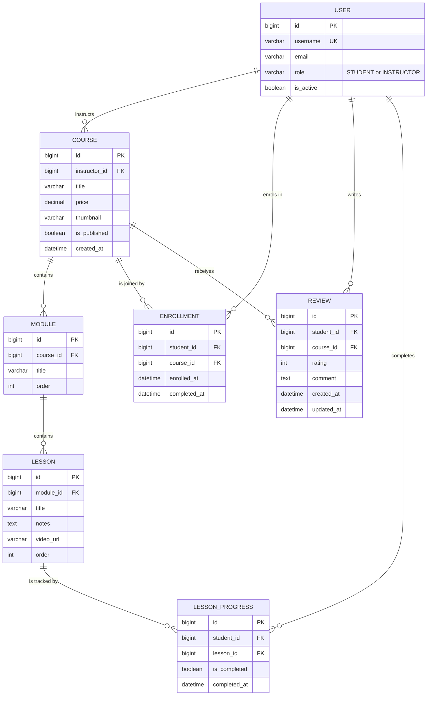

# CourseHub — Architecture & Design

> **Status:** Draft — content complete; pending team sign-off.
>
> **Task:** `AB#TBD`
> **Branch:** `feature/team-a-design-task` → `team-a/sprint-1`
> **Owner:** Team A
> **Last updated:** 6 November 2026

## Context and fixed decisions (given)

- One custom user model: `accounts.User`, based on `AbstractUser`, with a `role` field (`STUDENT` or `INSTRUCTOR`). It is already on `team-a/sprint-1`. No separate Student or Instructor user tables.
- Public registration lets the user choose **Student** or **Instructor**, as merged in PR #20 (task 3284).
- The merged `Course` model (PR #29, task 3291) has `title`, `instructor` (`CASCADE`), `price`, `thumbnail`, `is_published` and `created_at`. It has **no** `slug`, `description` or `updated_at`; those are not part of the current design.
- The merged `Module` and `Lesson` models (PR #32, task 3303) use `order` for sorting. `Module` has `course` + `title` + `order`; `Lesson` has `module` + `title` + `notes` + `video_url` + `order`.
- URLs use integer primary keys. `LessonProgress` links to `student` and `lesson` (tasks 3313 and 3322), not to `Enrollment`.
- Home and About belong to the `courses` app (tasks 3292 and 3293). A separate `core` app is **not** created now; see Open questions.

---

## 1. Entity relationship diagram (ERD)

**Required entities:** `User`, `Course`, `Module`, `Lesson`, `Enrollment`, `LessonProgress`, `Review`.

**Diagram:** Mermaid source below; GitHub renders it inline. To edit it visually, import the same block into draw.io (`Arrange > Insert > Advanced > Mermaid`) and save the export as `coursehub/docs/erd.drawio` if the team wants a diagram file in the repo.



### Plain-text view

For editors that do not render Mermaid, the same model as text:

```text
USER --1:N--> COURSE --1:N--> MODULE --1:N--> LESSON
 |               |                              |
 |               +--1:N--> ENROLLMENT           +--1:N--> LESSON_PROGRESS
 |               |                                             ^
 |               +--1:N--> REVIEW                              |
 |                                                             |
 +--1:N--> ENROLLMENT   (student side)                         |
 +--1:N--> REVIEW       (student side)                         |
 +--1:N--> LESSON_PROGRESS (student side) ---------------------+
```

Legend: `1:N` = one parent to many children. `LessonProgress` has two parents: the student who completed the lesson and the lesson itself.

`USER` appears on both sides of the model: as the instructor who owns a `Course`, and as the student who creates an `Enrollment`, `Review` or `LessonProgress`. The `role` field decides which side is valid; it is not a separate table.

### Keys and relationships

| Entity | Primary key | Foreign keys | Relationship / cardinality | Notes |
|---|---|---|---|---|
| `User` | `id` (`BigAutoField`) | — | 1 instructor → N `Course`; 1 student → N `Enrollment`; 1 student → N `Review` | `AbstractUser` + `role` (`STUDENT`/`INSTRUCTOR`). No separate Student/Instructor tables. Inherits `username` (unique), `email`, `password`, `is_active`, etc. |
| `Course` | `id` | `instructor_id` → `User` (`CASCADE`) | N `Course` → 1 instructor; 1 `Course` → N `Module`, N `Enrollment`, N `Review` | Matches merged PR #29. Fields: `title`, `price` (default `0`), `thumbnail`, `is_published` (default `False`), `created_at`. No `slug`, `description` or `updated_at`. |
| `Module` | `id` | `course_id` → `Course` (`CASCADE`) | 1 `Module` → N `Lesson` | Matches merged PR #32. Fields: `title`, `order` (default `0`); ordered by `order`. |
| `Lesson` | `id` | `module_id` → `Module` (`CASCADE`) | 1 `Lesson` → N `LessonProgress` | Matches merged PR #32. Fields: `title`, `notes`, `video_url` (optional), `order` (default `0`); ordered by `order`. |
| `Enrollment` | `id` | `student_id` → `User` (`CASCADE`); `course_id` → `Course` (`CASCADE`) | N `Enrollment` → 1 student + 1 course | Join model for Student ↔ Course. Unique `(student, course)`. `completed_at` is set when every lesson is complete. |
| `LessonProgress` | `id` | `student_id` → `User` (`CASCADE`); `lesson_id` → `Lesson` (`CASCADE`) | N `LessonProgress` → 1 student + 1 lesson | Join model for Student ↔ Lesson, per tasks 3313 and 3322. Unique `(student, lesson)`. `is_completed` + `completed_at`. |
| `Review` | `id` | `student_id` → `User` (`CASCADE`); `course_id` → `Course` (`CASCADE`) | N `Review` → 1 student + 1 course | Unique `(student, course)`. `rating` constrained to 1–5; `comment` optional. |

### Relationship notes

- **One-to-many:** `User → Course` (instructor), `Course → Module`, `Module → Lesson`, `User → Enrollment` (student), `Course → Enrollment`, `User → LessonProgress` (student), `Lesson → LessonProgress`, `User → Review` (student), `Course → Review`.
- **Many-to-many:**
  - Students ↔ Courses through `Enrollment`.
  - Students ↔ Lessons through `LessonProgress`, which carries `is_completed` / `completed_at`.
- **Unique constraints:** `User.username`; `Enrollment (student, course)`; `LessonProgress (student, lesson)`; `Review (student, course)`.
- **Delete behaviour:** `Course.instructor` is `CASCADE`, so deleting an instructor deletes the courses they own. `Module`, `Lesson`, `Enrollment`, `LessonProgress` and `Review` cascade from their parent course, student or lesson. Deleting a student removes their enrollments, reviews and lesson progress.
- **Role enforcement:** the database stores a generic `User` foreign key. `Course.instructor` must be `INSTRUCTOR`, while `Enrollment.student`, `Review.student` and `LessonProgress.student` must be `STUDENT`; enforce this in forms, services and the admin rather than with a database check.
- **Cross-field rules:** a `LessonProgress.lesson` must belong to a course the student is enrolled in, and a `Review` is only valid for a course the student is enrolled in. Both are application-level checks.

---

## 2. Django apps and ownership

| App | Responsibility | Owner | Status |
|---|---|---|---|
| `accounts` | Custom `User` model (`AbstractUser` + `role`: STUDENT / INSTRUCTOR), registration, login/logout, role-check decorators and mixins | _pending group session_ | Exists — `User` model and registration merged on `team-a/sprint-1` |
| `courses` | `Course`, `Module`, `Lesson`; Home and About pages, public catalogue, course detail, instructor create/edit/publish | _pending group session_ | App exists — `Course`, `Module` and `Lesson` merged (PRs #29/#32), Home merged (PR #31); course detail and studio in Sprint 2 |
| `enrollments` | `Enrollment`, `LessonProgress`; enrol, "My Learning", mark lesson complete, progress % | _pending group session_ | App exists — models in Sprint 3 per tasks 3313/3322 |
| `reviews` | `Review`; rate and review a course (enrolled students only), average rating | _pending group session_ | App exists — models in Sprint 4 |

Home and About are owned by `courses` (tasks 3292 and 3293), not by a separate `core` app. Shared layout (`base.html`, navbar, CSS/JS) belongs to the person who owns the shared-template tasks in Sprint 1.

The scrum master reviews every PR and has the final say on its design. Every app also has a backup reviewer so work isn't blocked when the owner is away:

| App | Backup reviewer |
|---|---|
| `accounts` | _pending group session_ |
| `courses` | _pending group session_ |
| `enrollments` | _pending group session_ |
| `reviews` | _pending group session_ |

### App boundaries and dependencies

- **Dependency direction:** `accounts` ← `courses` ← `enrollments` ← `reviews`. An app may import from apps to its left, never to its right. This prevents circular imports and matches the build order across sprints: each app can be built and tested once the apps it depends on exist.
- **Why this split:**
  - Home and About live in `courses` because tasks 3292 and 3293 assign those pages there and they consume the course catalogue. A separate `core` app is not created now (see Open questions).
  - `Module` and `Lesson` live in `courses` because they only exist inside a course and are managed by the same instructor in the same screens.
  - `LessonProgress` lives in `enrollments`, not `courses`, because it describes a student's progress through a course, not the course content itself.
  - `reviews` is its own app because it is a self-contained feature arriving later, depends on enrollment (only enrolled students can review), and can be postponed without affecting other apps.
- **What each app must not own:**
  - `accounts` must not know about courses, enrollments or reviews. No course-related fields on `User`.
  - `courses` must not track who is enrolled or their progress; it only describes content.
  - `enrollments` must not edit course content; it only reads courses and lessons.
  - `reviews` must not create enrollments; it only checks that one exists.
  - No app other than `accounts` defines user or role models. There are no separate `Student` or `Instructor` tables.
- **Shared code / utilities:**
  - Role checks (`student_required`, `instructor_required`, and class-based mixins) live in `accounts` and are imported by every app. No app writes its own `request.user.role == ...` checks.
  - Always reference the user model with `settings.AUTH_USER_MODEL` in model fields and `get_user_model()` in code, never by importing `User` directly.
  - `base.html`, the navbar and shared static files are owned by the shared-template owner from Sprint 1. Other apps extend `base.html` and don't edit it without telling the owner.
  - Project-wide files (`settings.py`, root `urls.py`, `requirements.txt`) have a single owner: _pending group session_.

---

## 3. URL and permission table

Access levels: **Public**, **Authenticated** (any signed-in role), **Student-only**, **Instructor-only**, **Staff-only**. The brief names Public / Student-only / Instructor-only; Authenticated and Staff-only are added because `/dashboard/` is shared by both roles and `/admin/` is restricted by `is_staff`, not by course role.

**Built** means merged into `team-a/sprint-1` (currently at `f1d1f3b`). Anything from closed PR #22 — `/dashboard/`, `/my-learning/`, `/courses/studio/` and the styled login — is **Planned**, not built.

| URL | Page / purpose | View | Access level | Login required | Notes |
|---|---|---|---|---|---|
| `/` | Home / landing page | `courses.views.home` | Public | No | Built (PR #31). Shows up to eight published courses, newest first. |
| `/about/` | About the platform | `courses.views.about` | Public | No | Planned (task 3293, PR #23). |
| `/courses/` | Course catalogue | `courses.views.course_list` | Public | No | Built as a placeholder; lists published courses once the catalogue exists. URL name is `courses:list`. |
| `/courses/<int:pk>/` | Course detail, curriculum and reviews | `courses.views.course_detail` | Public | No | Planned (Sprint 2). Unpublished courses return 404 except to the owning instructor and staff. |
| `/accounts/register/` | Public registration | `accounts.views.register` | Public | No | Built (PR #20). Creates an account with the chosen role, **Student or Instructor**; auto-logs in and redirects to `/`. |
| `/login/` | Login | `LoginView` (`accounts/login.html`) | Public | No | Built (basic template). The styled login and `LoginForm` from PR #22 are **not** merged. |
| `/logout/` | Logout | `LogoutView` | Authenticated | Yes | Built. POST only. Redirects to `/`. |
| `/dashboard/` | Role-aware dashboard | `accounts.views.dashboard` | Authenticated | Yes | Planned. PR #22 is closed and not merged. |
| `/my-learning/` | Student's enrolled courses | `enrollments.views.my_learning` | Student-only | Yes | Planned (Sprint 3). |
| `/my-learning/<int:course_pk>/` | Course player overview | `enrollments.views.course_player` | Student-only | Yes | Planned. Requires an `Enrollment` for the student; otherwise 404. |
| `/my-learning/<int:course_pk>/lessons/<int:lesson_pk>/` | Lesson player | `enrollments.views.lesson_detail` | Student-only | Yes | Planned. The lesson must belong to the enrolled course; otherwise 404. |
| `/my-learning/<int:course_pk>/lessons/<int:lesson_pk>/complete/` | Mark lesson complete | `enrollments.views.lesson_complete` | Student-only | Yes | Planned. POST only. Writes `LessonProgress (student, lesson)` per tasks 3313/3322. |
| `/courses/<int:pk>/enroll/` | Enrol in a course | `enrollments.views.enroll` | Student-only | Yes | Planned. POST only; idempotent per `(student, course)`. |
| `/courses/<int:course_pk>/reviews/` | Create a review | `reviews.views.review_create` | Student-only | Yes | Planned. POST only; requires enrolment; one review per student per course. |
| `/courses/<int:course_pk>/reviews/<int:review_pk>/update/` | Edit own review | `reviews.views.review_update` | Student-only | Yes | Planned. Author only; other students and instructors get 404. |
| `/courses/studio/` | Creator Studio landing page | `courses.views.creator_studio` | Instructor-only | Yes | Planned. PR #22 is closed and not merged. |
| `/courses/studio/courses/create/` | Create a course | `courses.views.course_create` | Instructor-only | Yes | Planned. Sets `instructor` to `request.user`. |
| `/courses/studio/courses/<int:pk>/update/` | Edit course details | `courses.views.course_update` | Instructor-only | Yes | Planned. Owner only; other instructors get 404. |
| `/courses/studio/courses/<int:pk>/curriculum/` | Manage modules and lessons | `courses.views.course_curriculum` | Instructor-only | Yes | Planned. Owner only; covers module/lesson create, reorder and delete. |
| `/courses/studio/courses/<int:pk>/publish/` | Publish or unpublish | `courses.views.course_publish` | Instructor-only | Yes | Planned. POST only; owner only; toggles `is_published`. |
| `/admin/` | Django admin | `admin.site.urls` | Staff-only | Yes | Built. Requires `is_staff`; used to change a user's `role`. |

### Permission rules

- **Guest behaviour:** every route with **Login required = Yes** runs `login_required` / `LoginRequiredMixin` as the outermost check. A guest gets **302 to `/login/?next=<original URL>`**, never 403 — even on student-only or instructor-only pages. Django validates `next`, so it cannot be used as an open redirect. Public routes never redirect.
- **Wrong authenticated role:** a signed-in user with the wrong role gets **403 Forbidden** (`PermissionDenied`). Students on instructor-only pages and instructors on student-only pages are both rejected; the role is never silently downgraded. Instructors may still read public course detail pages, but cannot enrol or review.
- **Object-level rules:** role checks alone are not enough. Student routes scope querysets through `Enrollment.objects.filter(student=request.user)`, and objects outside that scope return **404**, not 403, so IDs cannot be probed. Instructor studio routes scope through `Course.objects.filter(instructor=request.user)`. Review edits scope to the author. Staff override ownership only inside `/admin/`.
- **Method rules:** logout, enrol, lesson completion, publish/unpublish and review create/edit are **POST only** with CSRF protection; a GET returns 405. Read pages are GET.
- **Where enforcement lives:** role checks use `accounts.decorators.instructor_required` and a matching `student_required` for function views, plus `InstructorRequiredMixin` / `StudentRequiredMixin` for class-based views. Ownership is enforced by scoped `get_queryset()` or an explicit check in the view or service layer. Templates only hide links (``) and are **never** the security boundary — the view still enforces the rule. Admin access relies on `is_staff`, not on `role`.
- **Post-success redirects:** current merged login and registration → `/`; logout → `/`; planned enrolment → `/my-learning/<int:course_pk>/`; planned review create/edit → the course detail page. Changing the auth redirect to `/dashboard/` needs a separate approved task.

---

## 4. Conventions

### Naming

- **Apps:** lowercase, plural nouns for apps that hold a collection of things (`accounts`, `courses`, `enrollments`, `reviews`). Home and About stay in `courses` (tasks 3292/3293); a `core` app is an open question, not a convention. No hyphens or underscores.
- **Models:** singular `PascalCase` (`Course`, `LessonProgress`, not `Courses`). Foreign keys are named after the related object, not its id (`instructor`, not `instructor_id`). Every FK and M2M sets `related_name` in plural (`course.modules`, `user.enrollments`). Every model defines `__str__`.
- **Views and URLs:**
  - View functions in `snake_case`, class-based views in `PascalCase` ending in `View` (`course_detail`, `CourseCreateView`).
  - Each app has its own `urls.py` with `app_name` set, included from the root `urls.py` with a prefix (`courses/`, `accounts/`, ...).
  - URL names use the **app namespace plus the action** (the pattern already merged: `courses:list`), and only these actions: `list`, `detail`, `create`, `update`, `delete`. Use `update`, not `edit`; `delete`, not `remove`. Actions outside these five use a clear verb (`enroll`, `complete`, `publish`). Do **not** add a second name such as `courses:course_list`; the team must confirm this rule in the design session (see Open questions).
  - URL names are always referenced with their app namespace (``, `reverse("courses:list")`). No hard-coded paths in templates or views.
  - URL paths are lowercase with hyphens (`my-courses/`, not `my_courses/`).
- **Templates:** lowercase `snake_case`, named after the page (`course_list.html`, `course_detail.html`, `course_form.html`). Partials start with an underscore (`_navbar.html`, `_course_card.html`).
- **Tests:** in `<app>/tests/` once an app has more than one test file (`test_models.py`, `test_views.py`), otherwise `<app>/tests.py`. Test classes end in `Tests` (`CourseModelTests`); test methods describe the behaviour (`test_draft_courses_hidden_from_catalog`). Run `python manage.py test` before every PR.
- **Branches and commits:** see `CONTRIBUTING.md`. Branches: `feature/<name>-<task-number>-<short-description>` (e.g. `feature/walid-3301-course-detail`), branched from and merged back into `team-a/sprint-<n>`. Commits: short imperative summary that says what changed (`Add Course model and admin`, not `fixes` or `update`). PR titles include the task number.

### Templates

- **Project-level template directory:** `templates/` at the project root, registered in `TEMPLATES["DIRS"]` as `BASE_DIR / "templates"`. Holds only shared layout: `base.html` and `partials/`.
- **App-level template directory:** each app keeps its own pages in `<app>/templates/<app>/` (e.g. `courses/templates/courses/course_list.html`). The repeated app name is deliberate: it namespaces templates so two apps can both have a `detail.html` without clashing. Requires `APP_DIRS: True` (Django's default).
- **Naming pattern:** `<app>/<page>.html`, rendered as `render(request, "courses/course_list.html", ...)`. Every page template starts with `` and fills `` and ``.
- **Shared partials:** site-wide pieces (navbar, footer, messages) in `templates/partials/`, included with ``. Partials used by only one app stay in that app's template folder (`courses/_course_card.html`). Home and About templates live in `courses/templates/courses/` (tasks 3292/3293). Changes to `base.html` or `templates/partials/` need the shared-template owner's review.

### Static files

- **CSS / JS / images location:**
  - Site-wide assets in `static/` at the project root (`static/css/main.css`, `static/js/main.js`, `static/img/`), registered with `STATICFILES_DIRS = [BASE_DIR / "static"]`.
  - App-specific assets in `<app>/static/<app>/` (e.g. `courses/static/courses/css/catalog.css`), namespaced like templates.
  - Always loaded with `` and ``, never hard-coded `/static/...` paths.
  - User uploads (course thumbnails) are **media**, not static: stored in `media/` (`MEDIA_ROOT`), served at `/media/` in development only, and listed in `.gitignore`.
- **Static URL and collection:** `STATIC_URL = "static/"`. For deployment, `STATIC_ROOT = BASE_DIR / "staticfiles"` and `python manage.py collectstatic`; `staticfiles/` is in `.gitignore`. In development, `runserver` serves static files automatically when `DEBUG = True`.
- **Third-party assets (CDN vs vendored):** we use **Bootstrap 5** (agreed by the team) from the jsDelivr CDN, with the exact version pinned, linked once in `base.html`: CSS in `<head>`, the JS bundle just before `</body>`. The tags are copied from the official Bootstrap quick-start page, including `integrity` attributes. No other template links Bootstrap. Our own styles go in `static/css/main.css`, loaded *after* Bootstrap so they can override it; Bootstrap's own files are never edited or copied. Reasons for the CDN: nothing extra to commit, and the whole team uses the same version. If we later need offline work or deployment without internet access, we switch to vendored copies in `static/vendor/`. Adding any other library needs a short note in the PR explaining why.

## 5. Sprint 1 in detail

### Goal

Ship a runnable Django foundation for CourseHub: the custom role-based user model, registration/login/logout, role checks, a public course catalogue, the first `Course` model and the shared layout every later sprint builds on. This document is the Sprint 1 design deliverable.

### Scope

- **In scope:** Django project setup, `accounts.User` with `STUDENT`/`INSTRUCTOR`, public registration with role choice, login/logout, role-check decorators and mixins, role-aware navigation, course catalogue route, initial `Course` model and admin, `Module` and `Lesson` models, Home page content, About page, and this architecture document.
- **Out of scope:** Module/Lesson management screens, enrolment, lesson progress, reviews, search, payments, media uploads beyond the `Course.thumbnail` field, a separate `core` app, and any dashboard beyond the basic post-login landing page.

### Deliverables

- A working `coursehub` Django project with `accounts`, `courses`, `enrollments` and `reviews` apps installed.
- `accounts.User` (`AbstractUser` + `role`) with an admin listing, plus registration that accepts both roles.
- Login and logout routes with templates that extend `base.html`.
- `instructor_required` and `InstructorRequiredMixin`, with tests for instructor, student and anonymous access.
- `courses:list` catalogue route and the merged `Course`, `Module` and `Lesson` models with admin registration.
- Home page (merged, task 3292) and About page (task 3293, PR #23).
- `coursehub/docs/architecture.md` agreed by the team.

### Definition of Done

Every task must satisfy all of the following before it is marked done:

1. Work is on a `feature/*` branch cut from `team-a/sprint-1`, with a PR into `team-a/sprint-1`.
2. The PR is reviewed and approved by a teammate (Scrum Master has final say).
3. The PR is merged; work sitting only in a closed PR does not count as built.
4. `python manage.py test` passes locally, and the output is pasted in the PR.
5. `python manage.py check` reports no issues; no secrets, `.env` or `db.sqlite3` are committed.
6. The change is exercised locally (page loads, redirect, 403 or POST behaviour as applicable).
7. The PR title contains the Azure task number and the description states what changed and how it was tested.

### Task split

Owners and backups are assigned in the group design session, not by one author. The task numbers and statuses below are taken from Azure and the merged PR history.

| Task | Task number | Owner | Depends on | Definition of Done |
|---|---|---|---|---|
| Django project, templates/static, `base.html` | 3280 | _pending group session_ | — | Merged PR #10; project boots and base layout renders. |
| Login and logout routes/templates | 3282 / 3285 | _pending group session_ | 3280, 3283 | Merged PR #12; `/login/` and `/logout/` work for both roles. |
| Custom `User` model with `role` | 3283 | _pending group session_ | 3280 | Merged PR #13; `AUTH_USER_MODEL` set, migration applied, admin works. |
| Public registration with role choice | 3284 | _pending group session_ | 3283 | Merged PR #20; Student and Instructor accounts can be created and log in. |
| Instructor role checks and tests | 3287 | _pending group session_ | 3283 | Merged PRs #14/#19; decorator and mixin return 403 for students and 302 for guests. |
| Role-aware navbar | 3288 | _pending group session_ | 3282, 3283 | Merged PR #30; links differ by role, logout uses POST. |
| Course catalogue route, view and test | 3279 | _pending group session_ | 3280 | Merged PR #18; `courses:list` returns 200 and is tested. |
| Initial `Course` model and admin | 3291 | _pending group session_ | 3283 | Merged PR #29; fields match the ERD, migration applied, admin searchable. |
| `Module` and `Lesson` models | 3303 | _pending group session_ | 3291 | Merged PR #32; models, ordering and migrations match the ERD. |
| Home page in `courses` | 3292 | _pending group session_ | 3280, 3279, 3291 | Merged PR #31; home view lives in `courses` and shows published courses. |
| About page in `courses` | 3293 | _pending group session_ | 3280 | PR #23 open; `/about/` renders and is reachable from the navbar. |
| This architecture document | _pending Azure lookup_ | _pending group session_ | 3283, 3291 | Sections 1–6 reviewed and agreed by Team A; PR merged. |

**Sprint 1 exit rule:** only task 3293 (About page) remains; PR #23 is still open. PRs #33 (module work) and #34 (thumbnail upload) belong to the Sprint 2 backlog, not to Sprint 1.

---

## 6. Sprints 2–4 (rough sketch)

### Sprint 2 — Creator studio & curriculum management

- **Theme:** instructors can create and organise course content.
- **Main features:** instructor course create/update/delete, thumbnail upload, Module and Lesson CRUD, lesson ordering, draft/publish toggle, Creator Studio screens, ownership checks on every studio route.
- **Models touched:** `Course` (validation and upload UI), `Module` and `Lesson` (models already merged in PR #32; Sprint 2 adds CRUD and ordering screens).
- **Risks:** object-level permission bugs (instructor editing another instructor's course), ordering/reordering edge cases, media upload configuration, scope creep into enrolment.
- **Exit criteria:** an instructor can build a complete draft course and publish it; a second instructor gets 404 on the first instructor's studio URLs.

### Sprint 3 — Enrollment & digital classroom

- **Theme:** students can enrol and work through a course.
- **Main features:** public course detail with curriculum, enrol action, My Learning list, course player, lesson player, mark lesson complete, progress percentage, completion state.
- **Models touched:** `Enrollment`, `LessonProgress` (`student` + `lesson`, per tasks 3313/3322), `Course` read-only.
- **Risks:** duplicate enrolments, progress rows for lessons outside the enrolled course, students probing other students' progress, completion calculation drift, N+1 queries on the course player.
- **Exit criteria:** an enrolled student can complete lessons and see progress; a non-enrolled student gets 404; an instructor gets 403 on student-only pages.

### Sprint 4 — Search, reviews & hardening

- **Theme:** discovery, feedback and release readiness.
- **Main features:** course search and filters, review create/edit for enrolled students, average rating on course cards/detail, role-aware dashboard, pagination, error pages, accessibility pass, broader test coverage and deployment checks.
- **Models touched:** `Review`, read models/annotations over `Course` and `Enrollment`; no new user tables.
- **Risks:** review spam or reviews from non-enrolled students, average-rating query cost, search scope creep, late UI polish colliding with the release date, insufficient time for end-to-end tests.
- **Exit criteria:** search and reviews work within the permission rules, the full test suite passes, and the Scrum Master signs off the release.

---

## Decisions log

The rows below record decisions already visible in merged code or in the Azure task descriptions. `Agreed by` must be completed in the group design session; this table is not proof that the whole team has agreed yet.

| Date | Decision | Rationale | Agreed by |
|---|---|---|---|
| 2026-11-05 | One `accounts.User` with `role`; no separate Student/Instructor tables | One identity, one login, role decides permissions | _pending group sign-off_ |
| 2026-11-05 | Public registration offers **Student** and **Instructor** | Matches merged PR #20 / task 3284 | _pending group sign-off_ |
| 2026-11-05 | `Course` matches merged PR #29: no `slug`, `description` or `updated_at`; `instructor` is `CASCADE` | Documentation must match shipped code | _pending group sign-off_ |
| 2026-11-05 | URLs use integer primary keys, not slugs | Tasks 3313/3322 use `pk`; avoids a second routing scheme | _pending group sign-off_ |
| 2026-11-05 | `LessonProgress` is keyed by `(student, lesson)`, not `(enrollment, lesson)` | Tasks 3313/3322 define the progress model this way | _pending group sign-off_ |
| 2026-11-05 | Home and About live in `courses`; no `core` app now | Tasks 3292/3293 assign them to `courses` | _pending group sign-off_ |
| 2026-11-05 | Keep the merged URL name `courses:list`; do not add a `course_list` alias | Avoids two names for one route; team to confirm the naming rule | _pending group sign-off_ |

## Open questions

1. **`core` app:** do we ever need one for shared pages/layout, or do Home/About stay in `courses` and shared templates remain project-level? Current answer: no `core` app in Sprint 1.
2. **URL naming:** keep `courses:list` (app namespace + action) for every route, or rename it to `courses:course_list` to match the `<model>_<action>` style? Until the team decides, **do not** create both.
3. **Auth destination:** the merged login/registration redirect to `/`. Should there be a `/dashboard/` at all, given PR #22 is closed? If yes, it needs its own task, tests and permission rules.
4. **Instructor self-registration:** merged PR #20 lets anyone register as an Instructor. Do we keep that for the demo, or restrict public registration to Students and promote instructors in admin?
5. **Course ownership on delete:** `Course.instructor` is `CASCADE`, so deleting an instructor deletes their courses. Is that acceptable, or should it become `PROTECT` later?
6. **Course fields:** do we need `slug`, `description` or `updated_at` for SEO/detail pages? Adding them later requires a migration and URL changes; current routes use `pk`.
7. **Owners and backups:** who owns each app, shared templates and project-wide files? To be filled in the group session.
8. **Design task number:** the Azure ID for this document is still `AB#TBD` and must be supplied before the PR is final.

## Group sign-off

To be completed by the team in the design session. A single author cannot sign for the group.

| Name | Role | Agreed |
|---|---|---|
| _pending group session_ | Scrum Master | _pending_ |
| _pending group session_ | Accounts owner | _pending_ |
| _pending group session_ | Courses owner | _pending_ |
| _pending group session_ | Enrollments owner | _pending_ |
| _pending group session_ | Reviews owner | _pending_ |
| _pending group session_ | Shared templates / static owner | _pending_ |
